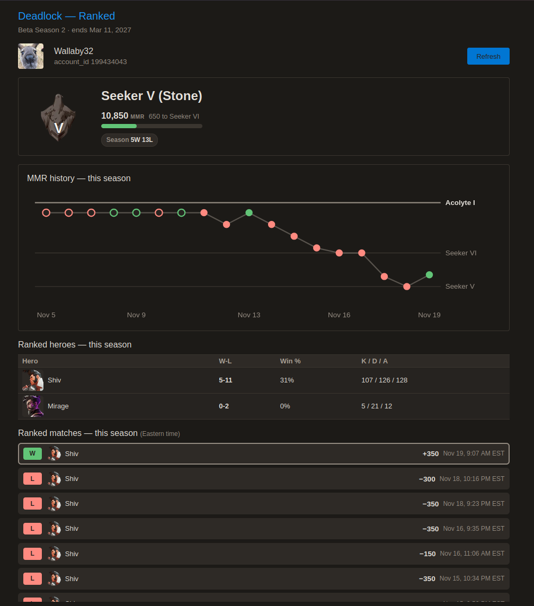
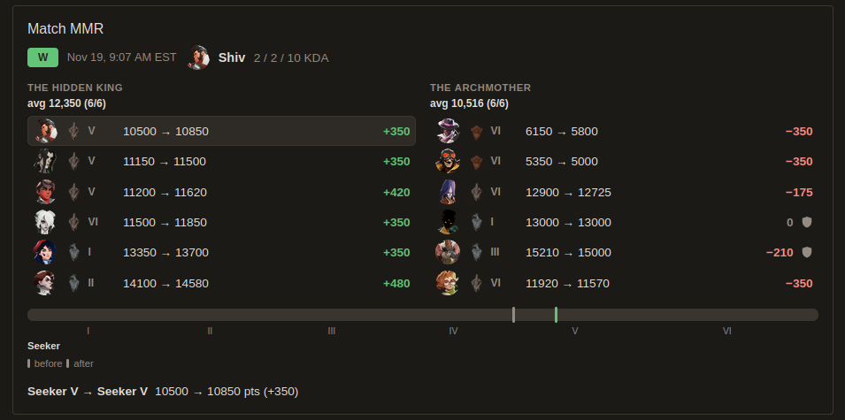

# deadlock-ledger

A self-hosted [Deadlock](https://store.steampowered.com/app/1422450) stat
tracker. It pulls **your own account's** match history straight from Steam's
Game Coordinator — no third-party API for your data — and renders it in a
single-page web dashboard.

> **Status: initial.** The backend is stable and the ranked dashboard is live,
> but the frontend is still being developed. See [Status](#status).

## Screenshots



The ranked season dashboard: rank card with in-subrank progress, MMR history
chart, per-hero record, and the season's match list.



The Match MMR section: every player's MMR before → after the match, both
teams' averages, and the own-account rank ladder.

## The idea

A personal stat tracker for Deadlock across **Standard, Brawl, and Ranked**.
Today it shows your all-time Standard summary and your current ranked season
(rank, form, per-hero MMR, W/L, KDA). The end goal is per-match detail — CS
score, teamfight share, damage taken, and the like.

## Layout

| Dir | Role | Stack |
| --- | --- | --- |
| [`gc-tap/`](gc-tap/) | Backend — fetches own-account match history, ranked state, and per-hero MMR from the Steam Game Coordinator | Rust, single binary |
| [`deadlock-lwc/`](deadlock-lwc/) | Frontend — single-page stat dashboard | [LWC](https://lwc.dev) on [LWR](https://lwr.dev), served by nginx |

Each directory is a full git subtree (imported with `git subtree add`); start
with its `AGENTS.md` for the details.

## How the pieces fit

```
Steam Game Coordinator
        │  your account (GC messages)
        ▼
 gc-tap ──fetch──▶  match-history.json · rank-data.json · hero-mmr.json
        │
        │  push.sh · systemd timer · every 10 min
        ▼
 deployment data dir  ──read-only mount──▶  /data/
        │
        ▼
 deadlock-lwc (LWC/LWR) ──nginx/Docker──▶ browser
```

The dashboard reads `/data/*.json` when present and falls back to the public
[api.deadlock-api.com](https://api.deadlock-api.com/v1) otherwise — used in dev
mode and to append the pre-2026 beta-era matches the GC no longer retains.

## gc-tap — backend

Own-account only: it logs in as you and never touches other players.

```sh
cd gc-tap
cargo build --release
./target/release/deadlock-gc-history login    # interactive (Steam Guard) — run once
./target/release/deadlock-gc-history status   # offline state check
./target/release/deadlock-gc-history check    # safe end-to-end verify
./target/release/deadlock-gc-history fetch    # write the data files
```

State lives in XDG dirs: config in `~/.config/deadlock-gc-history/`, data +
refresh token in `~/.local/share/deadlock-gc-history/`. `./push.sh` runs
`fetch` and publishes the three data files to the deployment host. Protocol
notes (ranked fields, season rollover, SO cache) are in `gc-tap/AGENTS.md`.

## deadlock-lwc — frontend

Pure client-side and single-account (pinned to your own account — no player
search).

```sh
cd deadlock-lwc
npm install
npm run dev     # dev server at http://localhost:3000
npm run build   # static build into site/
```

Deployed as a multi-stage Docker build (node builds, nginx serves) that
read-only-mounts the poller's data dir at `/data/`. Architecture, the ranked
data model, and gotchas are in `deadlock-lwc/AGENTS.md`.

## Status

- **Backend (`gc-tap`)** — stable. Fetches full match history, ranked state,
  and per-hero MMR; publishes on a 10-minute timer.
- **Frontend (`deadlock-lwc`)** — initial. Live today: all-time Standard summary
  and the current ranked season (rank card, badge chart, hero-MMR strip, ranked
  hero table, recent matches). In progress: Brawl mode and per-match detail
  (CS score, teamfight share, damage taken).
